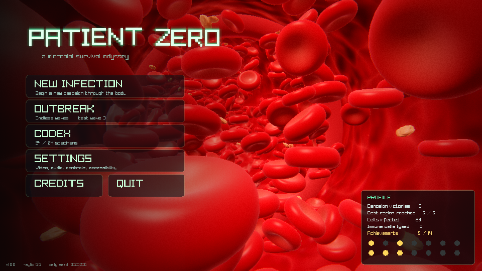
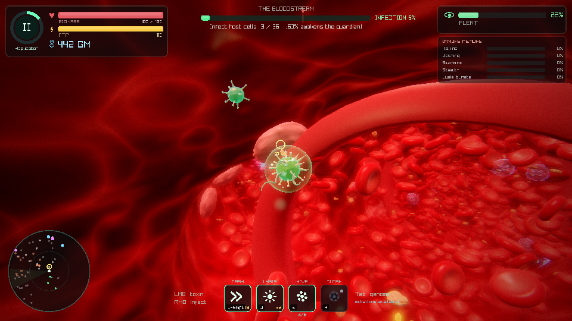
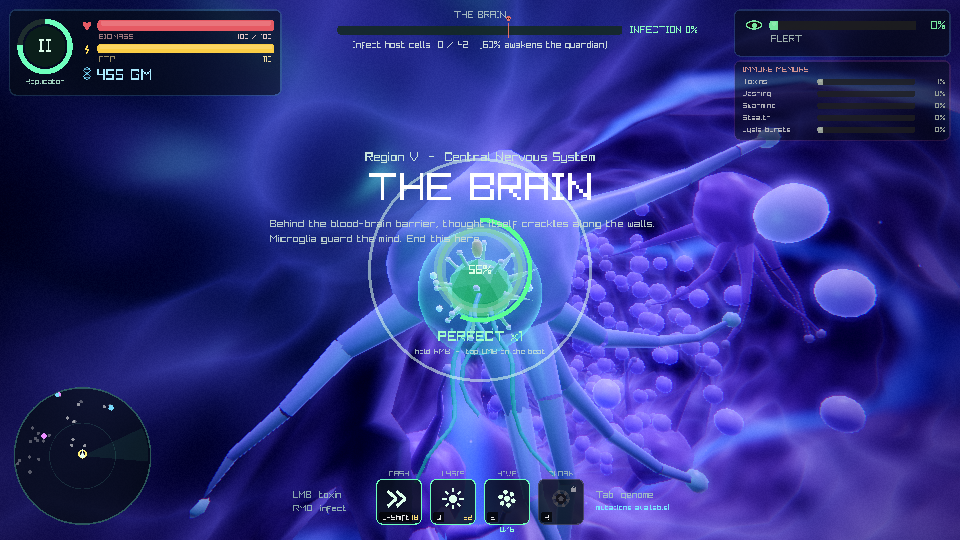
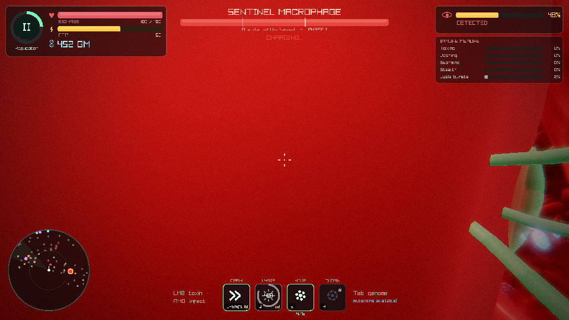
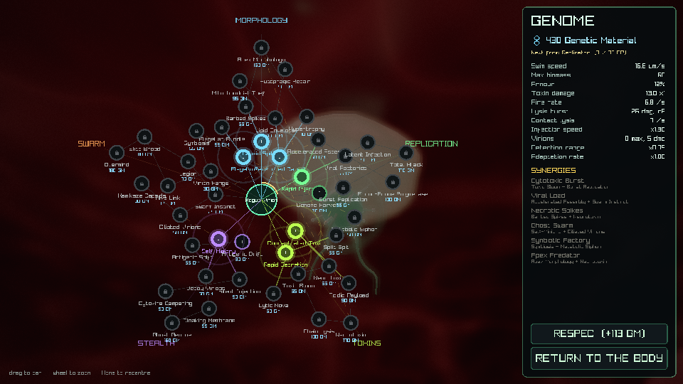
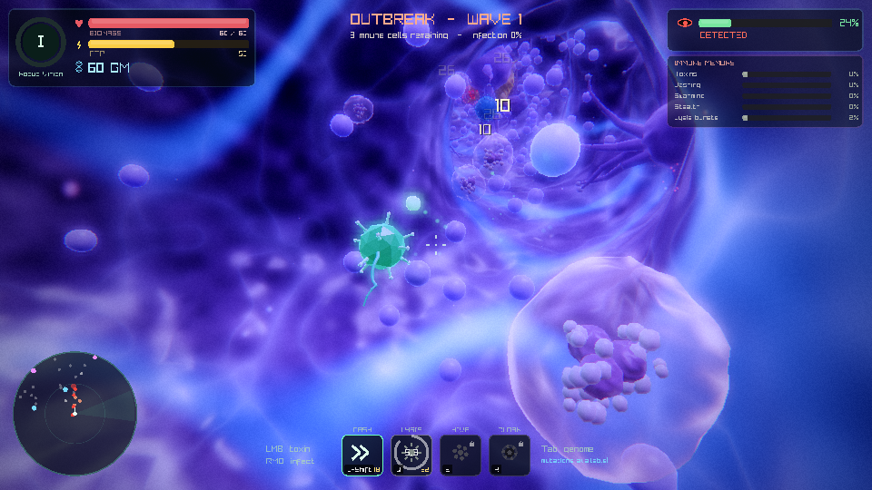

# PATIENT ZERO

*A microbial survival odyssey.* You are a single virion adrift in a human body. Dock on host cells, inject your genome, turn them into factories for your swarm, rewrite yourself through a 45-node mutation tree and evolve through five forms — while an adaptive immune system learns your tactics and comes back stronger. Fight through the **Bloodstream, Lungs, Gut, Lymph Nodes and Brain**, defeat each region's guardian, and spread until the body is yours.

C11 + raylib, single binary, **zero external assets**: every mesh, shader, texture, sound effect and note of music is generated at runtime.

| | |
|---|---|
|  |  |
|  |  |
|  |  |

*(Screenshots captured headlessly by the `--autotest` run under a software rasteriser at 960×540.)*

---

## Building

### Requirements
- macOS (Apple Silicon or Intel) or Linux
- raylib **5.5 or newer** (also builds against raylib 6.x)
- clang or gcc, `make` (CMake optional)

```sh
brew install raylib pkg-config        # macOS
make                                  # -> ./patient_zero
make run
```

| Target | What it does |
|---|---|
| `make` | Optimised build (`-O2`), all warnings on (`-Wall -Wextra -Wshadow`) |
| `make run` | Build and launch |
| `make debug` | `-O0 -g3` with AddressSanitizer + UBSan |
| `make release` | `-O3 -flto`, stripped |
| `make bundle` | Release build wrapped as `PatientZero.app` (macOS, ad-hoc signed, bundles a dynamic raylib if linked) |
| `make clean` | Remove build output |

raylib is located with `pkg-config`, then `/opt/homebrew`, then `/usr/local`. Override with `make RAYLIB_DIR=/path/to/raylib` (expects `include/` and `lib/`).

The exact one-liner from the original brief also works:
```sh
clang src/*.c src/*/*.c -Isrc -o patient_zero -I$(brew --prefix raylib)/include -L$(brew --prefix raylib)/lib -lraylib \
      -framework CoreVideo -framework IOKit -framework Cocoa -framework GLUT -framework OpenGL
```

Optional CMake: `cmake -B build-cmake && cmake --build build-cmake -j` (add `-DPZ_SANITIZE=ON` for sanitizers).

---

## Controls

| Action | Keyboard / Mouse | Gamepad |
|---|---|---|
| Swim | `W A S D` (relative to camera) | Left stick |
| Rise / sink | `Space` / `L-Ctrl` | RB / LB |
| Look / steer | Mouse | Right stick |
| Spit toxin | Hold **LMB** | RT |
| Infect host cell (hold) | Hold **RMB** near a wall cell | LT |
| Rhythm bonus while injecting | Tap **LMB** as the pulse ring meets the membrane | RT |
| Dash (i-frames) | `L-Shift` — also *mash* to escape a macrophage | A |
| Lysis burst (AoE, sheds antibodies) | `Q` | X |
| Hive call (send swarm at target / recall) | `E` | Y |
| Cloak (needs mutation) | `R` | B |
| Genome / mutation tree | `Tab` | Back |
| Pause | `Esc` / `P` | Start |
| Screenshot | `F12` (saved to the save folder) | |
| Photo mode | Pause → Photo mode (WASD fly, wheel = focus, F12 capture) | |

All keyboard bindings can be changed in **Settings → Controls**. In menus a gamepad drives the cursor with the left stick / d-pad; **A** clicks.

Debug keys: `F3` overlay (frame graph, pools, draw calls, lights), `F4` AI / path debug drawing, `F6` god mode, `F7` +500 GM, `F8` +100 EP.

---

## How to play

1. **Infect.** Host cells sit on the tissue walls (endothelium, pneumocytes, enterocytes, lymphocytes, neurons). Hold RMB next to one: your capsid docks and injects. A pulse ring contracts toward the membrane — tap LMB on the beat for big bonus progress and a combo; miss and you lose progress and make noise.
2. **Grow.** Infections grant **Genetic Material (GM)** and **Evolution Points (EP)**. Spend GM in the genome editor; EP drives evolution through five stages — *Rogue Virion → Replicator → Colony Organism → Apex Pathogen → Pandemic Entity* — each a cinematic metamorphosis with a bigger, tougher body and new mutation tiers. From Stage II infected cells bud **virions** that orbit you and fight; `E` hurls them at whatever you aim at.
3. **Stay hidden — or don't.** Immune cells see you along their vision cones (line of sight through the cave). Being seen and infecting raise **Alert**, which summons reinforcements and, past 55%, complement-cascade rings. Break line of sight and Alert decays.
4. **Outsmart the memory.** The **Immune Memory** panel tracks how much you rely on toxins, dashing, swarming, stealth and bursts. Overuse a tactic and the body adapts: toxin-shielded cells, faster dash-predicting hunters, macrophage swarms, longer vision, tougher cells. Memory partially carries between regions. Switch strategies.
5. **Kill the guardian.** At **60% infection** the region's guardian awakens. Beat it, collect its genome, and swim into the metastasis channel to spread to the next region.

**Resources:** Biomass (health, regenerates after 5 s without damage), ATP (stamina for toxin/dash/burst/cloak), GM, Infection %, Alert.

### The immune system
| Cell | Behaviour |
|---|---|
| **Neutrophil** | Fast swarming first responder; telegraphed lunge; may die into a sticky NET (slows you) |
| **Macrophage** | Slow tank that eats your virions and *engulfs* small pathogens — mash Dash to escape. You outgrow this at later stages |
| **NK cell** | Hunts and *cleanses your infected cells*; red-flash wind-up into a 40 µm/s dash |
| **Cytotoxic T cell** | Keeps range, fires leading perforin bolts |
| **Plasma B cell** | Hangs back releasing antibody swarms |
| **Antibody** | Homing IgG that sticks to you: −6% speed and +5% damage taken each; a lysis burst shakes them off |
| **Complement** | Expanding protein rings at high Alert — dash through or leave the plane |

Elites (larger, orange-tinted) appear more often in later regions and New Game+.

### Regions, hazards and events
- **Bloodstream** — fast current, elastic rings, fever, clotting cascades (shoot the clots), antibiotic strikes. Guardian: *Sentinel Macrophage* (charge, phagocytic vortex, summons, shockwaves).
- **Lungs** — mucus pools, cilia beating you back toward the throat, cough reflex. Guardian: *Alveolar Warden* (mucus barrage, volleys, spirals, cough gust).
- **Gut** — acid pools, peristaltic waves, commensal bacteria (allies with *Symbiosis*). Guardian: *Peristaltic Leviathan*, a segmented worm (charges, acid globs, segment ring bursts).
- **Lymph Nodes** — the immune system's barracks; lymphocyte surges. Guardian: *Germinal Citadel* (orbiting shield nodes must die before the core takes damage).
- **Brain** — electrical storms, glowing synapses. Guardian: *Microglial Overmind* (teleports, synaptic storms, homing bolts, three phases).

Side branches end in secret chambers with **genetic caches** and **mutagenic pods**.

### Mutation tree (45 mutations, 5 branches)
**Morphology** (flagella, spikes/contact lysis, armour, size, regeneration), **Replication** (infection speed, GM yield, virion factories, burst replication, latency), **Toxins** (damage, rate, split shot, neurotoxin poison, toxic clouds, acid piercing that dissolves shields, chain lysis, necrotoxin), **Stealth** (antigenic drift/shift, self-mimicry, silent injection, decoys, cloaking, ghost genome), **Swarm** (more/faster/tougher virions, hive link healing, kamikaze, elite brood, overmind). Mutations have prerequisites, stage gates and trade-offs; six cross-branch **synergies** unlock extra effects; **respec** refunds 70%. Mutations visibly change the pathogen: flagella count, barbed spikes, membrane layers, organelles, glow nodes and size.

### Modes
- **Campaign** — five regions, saved at each region start (Continue / Retry).
- **Outbreak** (unlocks after the campaign) — endless waves in a random region; every fifth wave brings a guardian.
- **New Game+** (unlocks after the campaign) — tougher, faster, more elites; stackable.
- **Seeds** — random, **daily challenge** (same body for everyone that day), or custom.
- **Difficulty** — Cautious / Standard / Pandemic.

Progress, settings, codex, achievements (14) and tutorial state live in
`~/Library/Application Support/PatientZero/profile.dat` (Linux: `~/.local/share/PatientZero/`).

---

## Technical overview

```
src/
  main.c                 entry, CLI (--autotest, --windowed WxH)
  core/   game.c (state machine, fixed 60 Hz timestep + interpolation), config.h (all tunables),
          rng, noise, math_utils, pool (generational handles), save, settings, input, autotest
  gfx/    shaders (GLSL 330 from memory), meshgen (procedural organisms), render (rlgl instancing),
          postfx (HDR chain), lights (16-light selection), particles (14k soft billboards), camera
  world/  sdf_cave (SDF volume + surface nets), region (5 region defs + generation), flow_field,
          hazards, events
  entities/ agents (pool loop, drifters, flora), player, hostcells, enemies (+director/outbreak),
            minions, projectiles, pickups, bosses
  systems/ ai (steering/flocking/perception), spatial_hash, combat, infection, immune_memory,
           mutation, evolution
  audio/  synth (DSP), sfx (48 synthesised effects), music (adaptive 7-layer score)
  ui/     widgets, hud, menu, mutation_ui, settings_ui, bestiary_ui (codex), debug_ui
```

- **World**: a 160×64×160 signed-distance "openness" grid is stamped with smooth-union capsules and spheres along a random-walk Catmull-Rom path (branches, secret chambers, alveolar clusters, lymph-node chambers, dendritic spurs), roughened with fBm/ridged noise, then meshed per 32³ chunk with **naive surface nets**. The same field is sampled trilinearly with an analytic gradient for collision, line of sight, AI wall avoidance and camera collision. A coarse flow field gives each region its current (laminar profile, peristaltic travelling waves, cough reversal).
- **Rendering**: everything renders into an RGBA16F target with a depth texture. Cells use a custom instancing path written directly against rlgl (ring-buffered VBO, per-instance mat4 carrying basis×scale, tint and phase) so it behaves identically on raylib 5.5 and 6.x. Shading: wrap diffuse, fake subsurface translucency, wet speculars, Fresnel rims and membrane "breathing" vertex wobble; translucent neutrophil/NK membranes show their lobed nuclei and granules. Tissue walls get noise-bumped normals, veins, animated caustics and a heartbeat pulse synced to the audio heartbeat. Post chain: bright pass → two-level Gaussian bloom, half-res blur for DOF/haze, chromatic aberration, heartbeat lens pulse, fever shimmer, ACES tonemap, per-region lift/gain/saturation/contrast, vignette, damage vignette, flashes, grain, letterbox.
- **Simulation**: generational agent pool (4096), counting-sort spatial hash, steering + flocking, perception ticks with LOS raymarching, reinforcement director weighted by immune memory, telegraphed boss pattern scheduler with three phases.
- **Audio**: 48 effects synthesised at boot (oscillators, SVF filters, noise, waveshaping, Schroeder reverb, RMS loudness normalisation) with 4-voice aliasing and 3D panning; a streamed stereo score with drone pad, Alert-driven heartbeat, bass, percussion, pentatonic motif, boss layer, fluid ambience, stingers, ping-pong delay and a pause muffle filter.

### Verification
`./patient_zero --autotest` runs a scripted smoke test: menu → campaign → autopilot play (infecting, fighting) → genome purchases → evolution → pause/settings/codex → boss intro, fight and death → portal → region clear → death and retry → every region → final boss → victory → Outbreak, writing screenshots, the synthesised SFX and a capture of the score as WAV, plus timing stats. It is used with Xvfb + Mesa llvmpipe for headless CI and runs clean under `make debug` (ASan/UBSan).

---

## Known limitations
- The default raylib bitmap font is used for all text (no external assets), so very small UI text is pixel-crisp rather than smooth.
- MSAA applies to the UI layer; the 3D scene is rendered into an HDR target without MSAA (post-processing softens edges). Turning MSAA on/off needs a restart.
- Saves are checkpoints at region start (Save & Quit keeps your genome and evolution, but the region is regenerated).
- Retina: the window uses logical (non-HiDPI) resolution for consistent performance; use the render-scale and resolution settings to trade sharpness for speed.
- Keyboard bindings are rebindable; gamepad layout is fixed.
